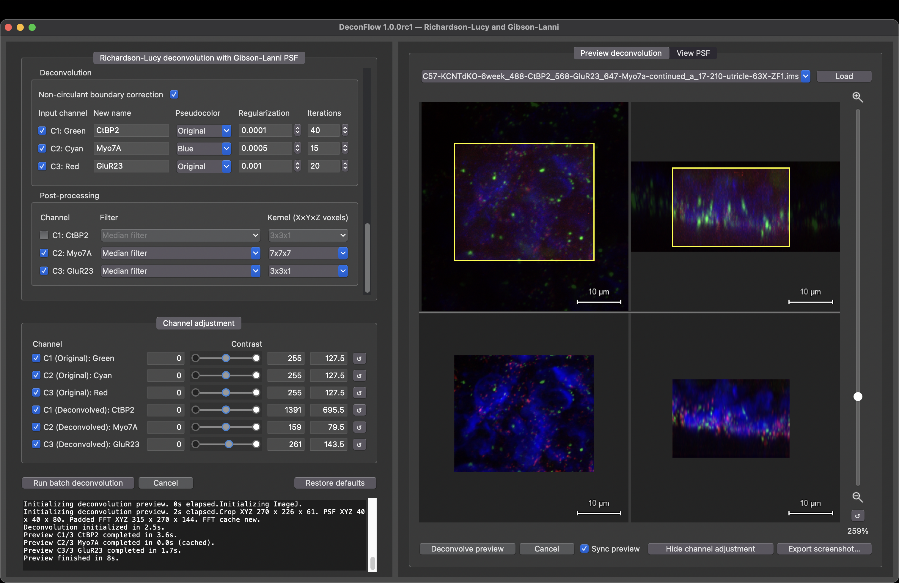
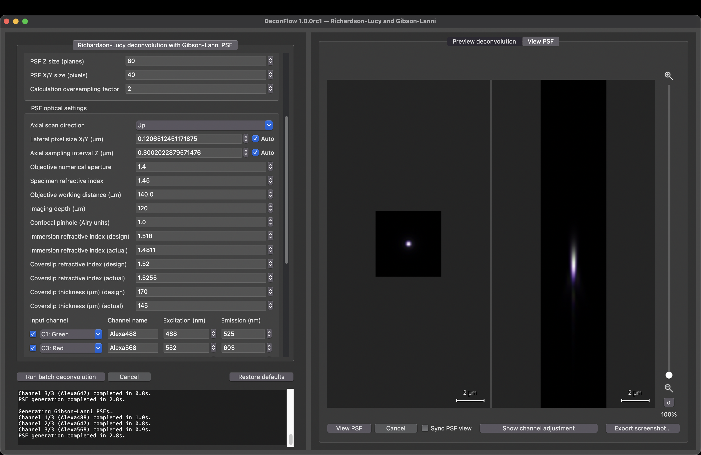

# DeconFlow

<p align="center">
  
  
</p>

## About

Why do we need another deconvolution app? Because we want all of the following at the same time:
- Gibson-Lanni point-spread functions to correct for all media the light passes through.
- Richardson-Lucy deconvolution with non-circulant edge correction and total variation regularization.
- GPU acceleration of deconvolution.
- Interactive preview showing XY and YZ dimensions of Z-stack with linked zoom and positioning between original and deconvolved preview and supporting running deconvolution on a crop, allowing you to see the result of a parameter change (usually) in seconds.
- Visualization of point-spread functions, allowing you to see the effect of changing a parameter on the point-spread function.
- Optional post-processing filters to smoothen out residual noise.
- Batch processing. 
- Intuitive GUI with all dependencies bundled.
- Open source.

This app uses the [psfmodels](https://github.com/tlambert03/PSFmodels) plugin to generate Gibson-Lanni point-spread functions. A minimal headless ImageJ installation with [CLIJ2](https://github.com/clij/clij2/) is bundled and integrated for GPU-accelerated Richardson-Lucy deconvolution with non-circulant edge detection and total variation regularization.

## Usage

1. Select an input folder with .ims files and an output folder.
2. Fill the point-spread function values.
3. Use the preview tab to load a file from your selected folder and drag the crop area to a representative section.
4. Tune the deconvolution parameters by running deconvolution on a small crop (use sync preview to rerun deconvolution on the crop).
5. Optionally apply a post-processing filter (e.g., a median filter to smoothen out noise).
6. Once the desired result is achieved on the preview, run batch deconvolution on your Z-stacks. 

## Install

Download the setup for your platform from [Releases](https://github.com/TomNaber/Imaris-Batch-Deconvolution/releases).

- **macOS:** open the DMG and drag the app to Applications (Apple Silicon: macOS 14+, Intel: macOS 13+).
- **Windows x64:** run `Setup.exe` (Windows 10+).

Python, Java, and ImageJ are included.

## Citation

If you use this app, please cite DeconFlow using GitHub’s **Cite this repository** option to generate a citation in APA or BibTeX format, or see [CITATION.cff](CITATION.cff).

## Dev install

Install [Miniforge](https://github.com/conda-forge/miniforge), then run:

```sh
git clone https://github.com/TomNaber/DeconFlow.git
cd DeconFlow
conda env create -f environment.yml
conda activate batch-deconvolution
python scripts/setup_imagej.py
python main.py
```
